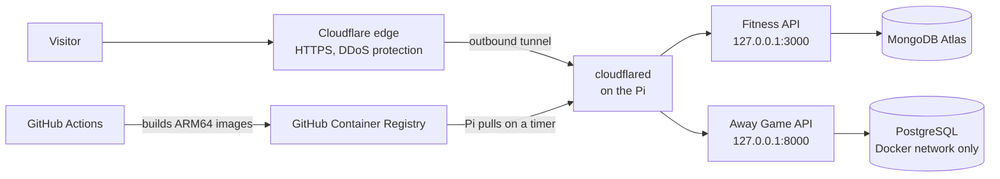

# pi-homelab

Infrastructure for self-hosting my portfolio projects on a Raspberry Pi 4, with no open router ports, no monthly cost, and automated deploys from GitHub Actions.

> **Status:** work in progress. Items marked 🚧 are planned and not built yet.

## What this hosts

| Project | Frontend | API | Database |
|---|---|---|---|
| [ActiveLife Tracker](https://github.com/NathanBurns3/Fitness-Tracker) | Vercel (`activelifetracker.com`) | Express/Node on the Pi (`api.activelifetracker.com`) | MongoDB Atlas |
| [Away Game](https://github.com/UC-Captstone/Away-Game) | Cloudflare Pages (`awaygameusa.com`) | FastAPI on the Pi (`api.awaygameusa.com`) | PostgreSQL 16 on the Pi |

Both projects were originally deployed on cloud platforms (AWS EC2 with NGINX, and Azure Functions). This repo documents the migration to a self-hosted setup.

## Architecture



**Key idea:** the Pi makes an *outbound* connection to Cloudflare, and Cloudflare routes visitor traffic back through it. The router has no port forwarding, and the home IP address is never exposed. This also works with a dynamic IP.

## Hardware

- Raspberry Pi 4, 4 GB RAM
- Raspberry Pi OS Lite (64-bit)
- microSD card (🚧 USB SSD planned, since databases wear out SD cards)
- Wired Ethernet

## Repo layout

```
pi-homelab/
├── README.md
├── scripts/
│   ├── setup-pi.sh            🚧 hardening + Docker install
│   └── backup-postgres.sh     🚧 nightly pg_dump
├── away-game/
│   ├── docker-compose.yml     🚧 API + Postgres
├── fitness-tracker/
│   ├── docker-compose.yml     🚧 API
└── deploy/
    ├── pull-and-restart.sh    🚧 pulls new images and restarts changed containers
    └── systemd units          🚧 timer that runs the script above
```

Application code and Dockerfiles live in each project's own repo. This repo only holds the runtime configuration.

## Security model

- **No inbound ports.** Access goes through Cloudflare Tunnel only.
- **SSH is key-only** and allowed only from the local network. The firewall (`ufw`) denies all other incoming traffic.
- **Containers publish ports on `127.0.0.1` only**, so nothing is reachable from the LAN or the internet except through the tunnel. (Docker bypasses `ufw` for published ports, so this matters.)
- **Postgres is not published at all.** It is reachable only from other containers on the Docker network.
- **Secrets live in `.env` files on the Pi** and are never committed. This repo contains only `.env.example` files with placeholder names.
- **Automatic security updates** via `unattended-upgrades`.
- **Rate limiting** in the apps and in Cloudflare.
- 🚧 Pi moved to a guest network or VLAN, so a compromised container can't reach other devices at home.

## Setup (summary)

1. Flash Raspberry Pi OS Lite (64-bit) with Raspberry Pi Imager. Set a hostname, enable SSH, and paste in a public SSH key.
2. SSH in from a Mac with `ssh user@hostname.local`, and reserve the Pi's IP in the router.
3. Run `scripts/setup-pi.sh` 🚧 to update the OS, enable the firewall and automatic updates, and install Docker.
4. Add the domains to Cloudflare, switch their nameservers, and create a tunnel. Install the connector on the Pi using the token the dashboard provides.
5. Clone this repo on the Pi, copy each `.env.example` to `.env`, and fill in real values.
6. Run `docker compose up -d` in each project folder.
7. Add public hostnames to the tunnel in the Cloudflare dashboard.

Detailed steps will go in `docs/` 🚧.

## Deployment (CI/CD)

🚧 Planned pull-based flow, so nothing connects *into* the home network:

1. A push to a project's deploy branch triggers GitHub Actions.
2. Actions runs the tests, builds an ARM64 Docker image, and pushes it to GitHub Container Registry, tagged with the commit SHA and `latest`.
3. A systemd timer on the Pi runs `docker compose pull` and `docker compose up -d` every few minutes, restarting only containers whose image changed.
4. Rolling back means pinning the compose file to an earlier SHA tag.

Frontends deploy automatically through Vercel and Cloudflare Pages.

## Backups

🚧 A nightly `pg_dump` of the Away Game database, compressed and copied off the Pi. MongoDB data lives on Atlas.
